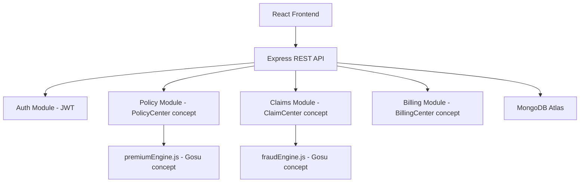

# InsureFlow — Smart Motor Insurance & Claims Management Platform

> **An external full-stack insurance platform inspired by Guidewire InsuranceSuite architecture and workflows.**
> Built for academic demonstration. Not an actual Guidewire implementation.

---

## Project Description

InsureFlow is a complete full-stack web application that demonstrates real-world motor insurance business workflows including policy lifecycle, FNOL claim intake, automated fraud/risk assessment, adjuster review workflows, billing, and enterprise dashboards — all inspired by concepts from Guidewire InsuranceSuite (PolicyCenter, ClaimCenter, BillingCenter, Gosu).

---

## Technology Stack

| Layer | Technology |
|-------|-----------|
| Frontend | React 19, Vite, Tailwind CSS, React Router, Axios, Recharts, Lucide React |
| Backend | Node.js, Express.js, JWT Auth, bcrypt |
| Database | MongoDB Atlas, Mongoose |
| Testing | Jest, Supertest |

---

## Features

### Customer
- Register & login
- Generate motor insurance quote with transparent premium breakdown
- Purchase policy from quote
- View active policies with full detail
- File FNOL (First Notice of Loss) / accident claim
- Track claim status with timeline
- View payment history

### Agent
- View all policies and quotes
- Generate quotes for customers

### Adjuster
- View claims queue with risk scores
- Approve, reject, investigate, or settle claims
- Add adjuster notes

### Admin
- Enterprise dashboard with charts
- View/search users, policies, claims, payments
- Risk distribution and claims status analytics

### Platform
- Automated fraud/risk scoring engine (deterministic, rule-based)
- Transparent premium calculation engine
- Full claim status workflow with timeline
- Role-based access control
- Guidewire InsuranceSuite concept mapping page
- Gosu business rule concept demonstration page

---

## Architecture



---

## Database Design

| Collection | Key Fields |
|-----------|-----------|
| users | name, email, password (hashed), phone, role |
| quotes | quoteNumber, customerId, vehicle/driver details, premium breakdown |
| policies | policyNumber, customerId, vehicle, coverage, premium, status |
| claims | claimNumber, policyId, accidentDetails, riskScore, riskLevel, status |
| payments | paymentNumber, policyId, amount, method, status |

---

## Guidewire Concept Mapping

| InsureFlow Module | Guidewire Concept |
|------------------|------------------|
| Policy Module + premiumEngine.js | PolicyCenter |
| Claims Module + fraudEngine.js | ClaimCenter |
| Payments Module | BillingCenter |
| premiumEngine.js + fraudEngine.js | Gosu business rules |
| Express REST API | Guidewire Cloud REST API |

> This mapping is for academic concept demonstration only.

---

## Business Rules (Premium Engine)

```
Base Premium = vehicleValue × 3%
+ Driver Age Risk (< 25: +₹5000, 25–40: +₹2000, > 40: +₹1000)
+ Claim History (0 claims: −₹2000 NCB, 1–2: +₹3000, > 2: +₹6000)
+ Vehicle Age (> 8 years: +₹3000)
+ Coverage (Comprehensive: +₹5000, Third Party: +₹1500)
+ Location Risk (Mumbai: +₹1500, Delhi: +₹1400, etc.)
Minimum premium: ₹5000
```

## Business Rules (Fraud/Risk Engine)

```
+25 points — More than 3 previous claims
+20 points — Claim filed within 30 days of policy activation
+25 points — Claim amount ≥ 80% of vehicle value
+10 points — Claim amount > ₹1,00,000
+10 points — New vehicle + claim shortly after policy creation
+5 points  — Theft or fire claim type

Score 0–30  → LOW RISK
Score 31–60 → MEDIUM RISK
Score 61–100 → HIGH RISK (auto-flagged for investigation)
```

---

## Installation

### Prerequisites
- Node.js 18+
- npm
- MongoDB Atlas account (or local MongoDB)

### 1. Clone / Download
```bash
# The project is already in:
C:\Users\RexBritto\Downloads\Insureflow\
```

### 2. Backend Setup
```bash
cd backend
npm install
```

Create `.env` file in `backend/`:
```env
MONGODB_URI=mongodb+srv://<user>:<pass>@cluster.mongodb.net/insureflow
JWT_SECRET=your_secret_key_here
PORT=5000
NODE_ENV=development
```

### 3. Frontend Setup
```bash
cd frontend
npm install
```

---

## Running the Application

### Start Backend
```bash
cd backend
npm run dev
# Backend runs on http://localhost:5000
```

### Start Frontend
```bash
cd frontend
npm run dev
# Frontend runs on http://localhost:5173
```

### Seed Database
```bash
cd backend
npm run seed
```

---

## Demo Credentials

| Role | Email | Password |
|------|-------|----------|
| Admin | admin@insureflow.com | Admin@123 |
| Customer | customer@insureflow.com | Customer@123 |
| Customer 2 | priya@insureflow.com | Customer@123 |
| Agent | agent@insureflow.com | Agent@123 |
| Adjuster | adjuster@insureflow.com | Adjuster@123 |

---

## API Endpoints

### Auth
| Method | Endpoint | Description |
|--------|----------|-------------|
| POST | /api/auth/register | Register customer |
| POST | /api/auth/login | Login |
| GET | /api/auth/me | Get current user |

### Quotes
| Method | Endpoint | Description |
|--------|----------|-------------|
| POST | /api/quotes | Generate quote |
| GET | /api/quotes | List quotes |
| GET | /api/quotes/:id | Get quote detail |

### Policies
| Method | Endpoint | Description |
|--------|----------|-------------|
| POST | /api/policies | Purchase policy |
| GET | /api/policies | List policies |
| GET | /api/policies/:id | Policy detail |
| PUT | /api/policies/:id | Update policy |

### Claims
| Method | Endpoint | Description |
|--------|----------|-------------|
| POST | /api/claims | Submit FNOL/claim |
| GET | /api/claims | List claims |
| GET | /api/claims/:id | Claim detail |
| PUT | /api/claims/:id/status | Update claim status |

### Payments
| Method | Endpoint | Description |
|--------|----------|-------------|
| POST | /api/payments | Record payment |
| GET | /api/payments | Payment history |

### Admin
| Method | Endpoint | Description |
|--------|----------|-------------|
| GET | /api/admin/dashboard | Admin dashboard stats |
| GET | /api/admin/claims | All claims |
| GET | /api/admin/policies | All policies |
| GET | /api/admin/users | All users |
| GET | /api/admin/payments | All payments |

---

## Running Tests
```bash
cd backend
npm test
```

Tests cover: registration, login, JWT auth, premium engine rules, fraud/risk engine rules.

---

## Seed Data Summary

After running `npm run seed`:
- 10 users (1 admin, 5 customers, 2 agents, 2 adjusters)
- 8 policies (active, expired)
- 6 claims (LOW/MEDIUM/HIGH risk, all status types)
- 8 payment records

---

## Project Structure

```
insureflow/
├── backend/
│   ├── config/          # DB connection
│   ├── controllers/     # Route handlers
│   ├── middleware/       # Auth, error handler
│   ├── models/          # Mongoose models
│   ├── routes/          # Express routes
│   ├── seeds/           # Demo data seeder
│   ├── services/        # premiumEngine.js, fraudEngine.js
│   ├── tests/           # Jest test suites
│   ├── .env.example
│   └── server.js
└── frontend/
    └── src/
        ├── components/  # Shared UI components
        ├── context/     # AuthContext
        ├── layouts/     # Sidebar, AppLayout
        ├── pages/       # Auth, Dashboard, Policies, Claims, etc.
        ├── services/    # api.js (Axios service layer)
        └── utils/       # helpers.js (formatters, colors)
```

---

## Known Limitations

- No image upload (image URL accepted as text)
- Mock payment processing (no real payment gateway)
- No email notifications
- No policy renewal workflow
- No multi-currency support
- Tests require MongoDB connection

---

## Future Enhancements

- Real document/image upload (Cloudinary/S3)
- Email notifications on claim status change
- Policy renewal and endorsement workflows
- Mobile-responsive improvements
- Real-time claim status updates (WebSocket)
- Export reports to PDF
- Advanced fraud ML model integration
